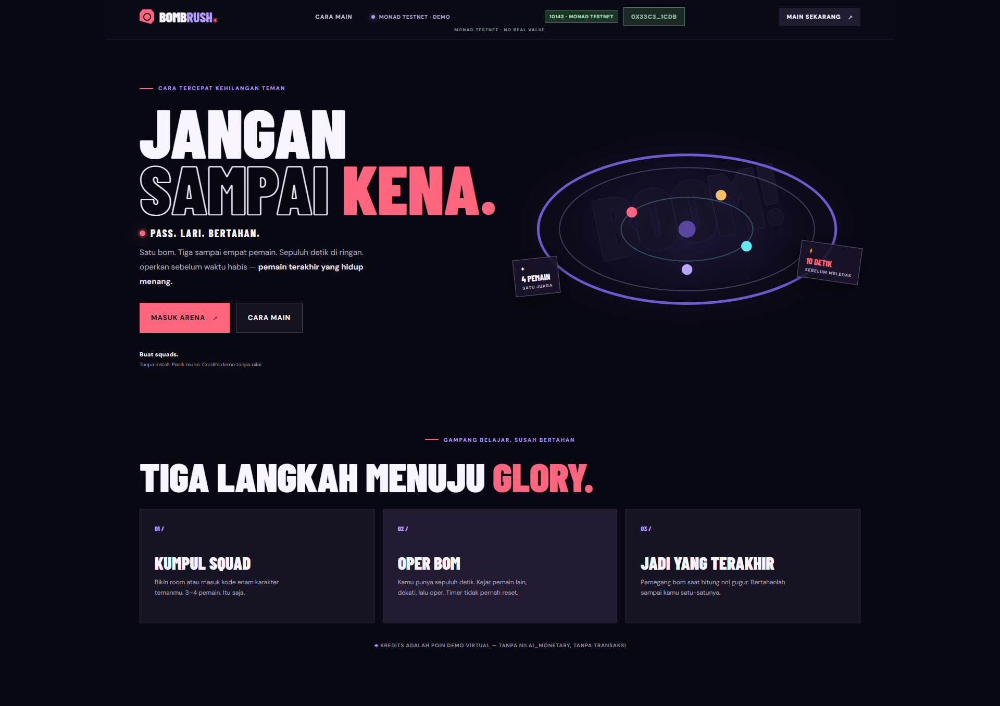

# BOMB RUSH 3D 💣

**Pass the bomb. Keep moving. Be the last one standing.**

BOMB RUSH 3D is a browser-based multiplayer survival game where 3–4 players compete in a 3D arena. Hold the bomb for too long and you're out. Pass it to another player, manage your stamina, and survive until everyone else is eliminated.

**Play now:** https://bombrush.my.id/



No game installation required. Open the website, gather your friends, and enter the arena.

## How to Play

1. **Create a room** and share the room code with your friends, or join an existing room.
2. **Get into the arena** and prepare for the round.
3. **Pass the bomb.** You have 10 seconds before it explodes. Get close to another player and pass it before the timer reaches zero.
4. **Stay alive.** The player holding the bomb when the timer expires is eliminated.
5. **Win the match.** Keep going until you're the last player standing.

The bomb timer does not reset when the bomb is passed, so timing and positioning matter. Running helps you catch up to other players, but it consumes stamina.

## Controls

### Desktop

| Action | Control |
|---|---|
| Move | `W`, `A`, `S`, `D` |
| Run | `Shift` |
| Pass the bomb | `E` |
| Rotate the camera | Click and drag |
| Zoom | Mouse scroll |
| Pause | `Esc` |

### Mobile

For the best experience, play in landscape mode.

- Use the left joystick to move.
- Use the run button to sprint.
- Use the pass button to pass the bomb.
- Swipe on the right side of the screen to rotate the camera.

## Features

- **3D arena:** Play in a compact third-person survival arena.
- **Multiplayer rooms:** Create a room and invite friends using a room code.
- **Timed bomb mechanic:** Pass the bomb before the countdown ends.
- **Stamina system:** Choose when to sprint and when to save your energy.
- **Desktop and mobile controls:** Play from a desktop browser or a mobile browser.
- **Real-time game server:** Game state and player interactions are handled by the backend.
- **Monad Testnet support:** Blockchain-related features use the Monad test network, not mainnet.

## Run Locally

You can run BOMB RUSH 3D on your own computer for local development and testing.

### Requirements

Install the following first:

- [Node.js](https://nodejs.org/) — version 20 or later recommended
- npm, included with Node.js
- [Git](https://git-scm.com/)

### 1. Clone the repository

Open a terminal and run:

```bash
git clone https://github.com/Prasetyant0/Bomb-Rush.git
cd Bomb-Rush
```

### 2. Install dependencies

Run this command from the project root:

```bash
npm install
```

This installs the dependencies for the monorepo workspaces.

### 3. Configure the environment

Copy the example environment file.

**Windows PowerShell**

```powershell
Copy-Item .env.example .env
```

**macOS / Linux**

```bash
cp .env.example .env
```

The root `.env.example` contains the backend's default configuration. You can keep the default values for a basic local setup.

| Variable | Purpose | Default |
|---|---|---|
| `PORT` | Backend port | `3000` |
| `HOST` | Backend host | `0.0.0.0` |
| `ROOM_EXPIRY_SECONDS` | Room expiration time | `600` |
| `COUNTDOWN_SECONDS` | Match countdown | `15` |
| `ALLOW_DEMO_BOT` | Allow demo bot support | `true` |
| `ENABLE_REAL_VALUE_STAKES` | Real-value staking flag | `false` |
| `MONAD_RPC_URL` | Monad RPC endpoint | Empty |
| `DATABASE_URL` | Database connection string | Empty |

Do not commit your personal `.env` file or private credentials.

### 4. Build the project

From the project root, run:

```bash
npm run build
```

### 5. Start the backend

Open a terminal in the project root and run:

```bash
node apps/server/dist/index.js
```

The backend should start on port `3000` with the default configuration.

To check that it is running, open:

http://localhost:3000/health

### 6. Start the frontend

Open a **second terminal** in the project root and run:

```bash
npm run dev --workspace=apps/web
```

Open the local URL printed in the terminal by the frontend development server.

Keep both terminals running while using the locally hosted game. If the frontend cannot connect to the backend, check the frontend's server URL configuration and make sure it points to your local backend.

> If you want to test blockchain-related features locally, configure the appropriate Monad Testnet RPC and wallet settings as required by the application. Use testnet assets only.

## Run Tests

The repository includes workspace scripts for testing, type checking, and building.

Run these commands from the project root:

```bash
npm test
npm run typecheck
npm run build
```

## Technology Stack

| Technology | Role |
|---|---|
| React and TypeScript | Frontend application |
| Three.js / React Three Fiber | 3D game environment |
| Node.js and Fastify | Backend server and HTTP API |
| Socket.IO | Real-time multiplayer communication |
| Zod | Shared data validation |
| Solidity | Smart contracts |
| Monad Testnet | Blockchain network integration |

## Project Structure

```text
Bomb-Rush/
├── apps/
│   ├── web/             # Frontend and 3D game
│   └── server/          # Multiplayer backend
├── packages/
│   └── shared/          # Shared types and validation
├── contracts/           # Smart contracts
├── docs/                # Project documentation
├── .env.example         # Example environment configuration
├── package.json
├── package-lock.json
└── README.md
```

## Network and Safety

BOMB RUSH 3D is designed for gameplay and testing on Monad Testnet. Testnet assets have no intended real-world monetary value. Do not send mainnet funds or share your wallet's private key or recovery phrase.

## Built at

**Monad Blitz Jogja Vol. 2**

BOMB RUSH 3D — One bomb, a few players, and no room for hesitation.

Linkedin Post: https://lnkd.in/p/gY6q26MP
