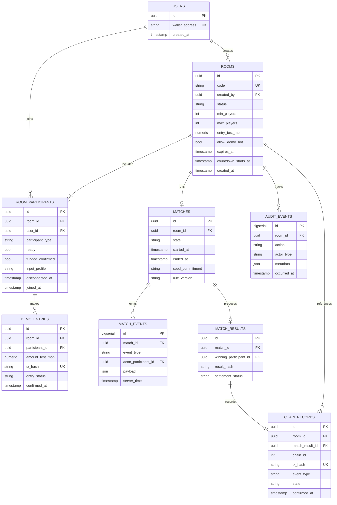

# ERD — Entity Relationship & Data Integrity Design

## 1. Logical entity relationship diagram

## 2. Implementation notes
- `USERS.wallet_address` normalized to lowercase for uniqueness, retain checksum display separately. For guests, use a separate ephemeral session ID; do not pretend guests have wallet addresses.
- `ROOMS.entry_test_mon` is immutable once the room has the first participant; PostgreSQL `numeric(36,18)` or store integer wei `numeric(78,0)` for blockchain interactions. Prefer integer wei in service contracts.
- `ROOM_PARTICIPANTS` requires unique `(room_id, user_id)` for humans, and partial unique index at most one bot per room. The single bot has `participant_type='BOT'`, optionally owned by a labeled demo treasury wallet.
- Enforce allowed player count in service transaction: `min_players=3`, `max_players=4`, and capacity checks must be atomic.
- `DEMO_ENTRIES` exists **only if P2 optional testnet escrow is implemented**; otherwise keep a virtual `demo_pool_points` field/read-model, no payments table or fake transaction hashes.
- `MATCH_RESULTS.match_id` unique; `MATCHES.room_id` unique; `CHAIN_RECORDS` unique `(chain_id, tx_hash)` and `(room_id, event_type)` where relevant.
- `MATCH_EVENTS` is append-only and can be pruned or archived after results are finalized; do not log secret material.
- Use `TIMESTAMPTZ` for all times; server derives deadline from authoritative clock and stores UTC timestamps.

## 3. Proposed enum domains
- `room_status`: CREATED, WAITING, FUNDING, COUNTDOWN, LIVE, FINISHED, CANCELED, ABORTED, REFUND_PENDING, REFUNDED, SETTLEMENT_PENDING, SETTLED.
- `participant_type`: HUMAN, BOT.
- `entry_status`: PENDING, CONFIRMED, FAILED, REFUNDED (test only).
- `match_event_type`: JOIN, LEAVE, READY, START, PASS, SPRINT_START, SPRINT_STOP, EXPLODE, ELIMINATE, DISCONNECT, RECONNECT, FINISH, ABORT.
- `chain_state`: QUEUED, SUBMITTED, CONFIRMED, FAILED.

## 4. Integrity invariants
1. A room cannot host two active matches.
2. At most four participants, at most one bot, at least two humans if bot included.
3. All accepted funded entries equal frozen per-room demo amount.
4. Only one winner per finished match and winner must be an active participant in that match.
5. Match can settle or cancel/refund but cannot do both.
6. No duplicate transaction processing, no double recording, no negative balances.
7. All deposits/records tagged by correct chain and contract address; reject mainnet in hackathon mode.

## 5. Cross-device persistence and simulation (v0.3)
- `ROOM_PARTICIPANTS.input_profile` is optional analytics (`DESKTOP_KBM`, `MOBILE_TOUCH`, `UNKNOWN`) **not** a source of gameplay authority. Never infer user skill or give different speed based on device.
- Persist `MATCHES.rule_version = 'bomb-rush-v0.3'` so old match audit records are not interpreted with new stamina settings.
- Live stamina values, joystick pointer IDs, camera position and input sequence counters are **ephemeral simulation/client state**, not database columns. Keep authoritative per-player stamina in the server's active room state; optionally include sampled authoritative values in append-only game events for disputes/debugging.
- Room and match event indexes: `(room_id, occurred_at)`, `(match_id, server_time)`; room join uniqueness and winner uniqueness remain enforced.
- `SESSION_TOKENS` (if implemented) should be short-lived and server-hashed; avoid storing full unencrypted token strings. Add `last_seen_at` for safe reconnect.
