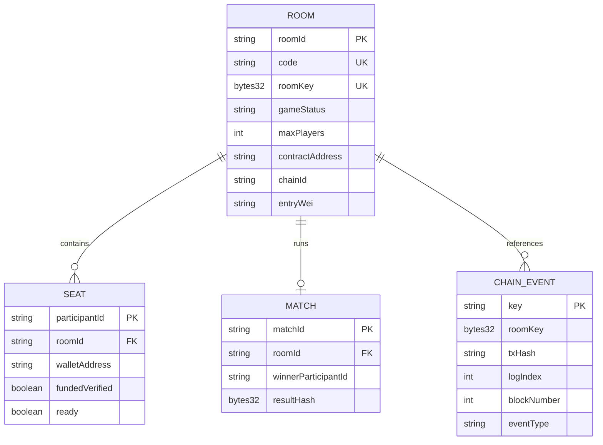

# ERD — Logical Data Model & Persistence Boundaries v0.5

**Important:** No PostgreSQL in P0. This document is a logical mapping for frontend/server cache and a potential future DB, NOT a migration plan. Financial source of truth is contract storage and event receipts, never this in-memory projection.

## Logical entities

## Rules
- One `roomKey` contract identity maps to one gameplay room; six-char code maps to key in ephemeral cache; must include recovery link containing actual roomKey for app restart.
- Wallet address unique within a room; every verified funded seat corresponds to an on-chain depositor.
- No persistent player statistics in P0; room and match expire in memory. On restart, contract knows funds but gameplay cannot automatically reconstruct positions/timers or winner.
- Chain events dedupe by `(chainId, txHash, logIndex)`; tx receipt success + event matching and read state are source of truth. Never trust a client-inserted `funded` boolean.
- Exact financial fields stored as decimal wei strings on app side, `uint256` contract side; no FLOAT/DOUBLE columns should ever represent pool.

## Later upgrade (P2)
Durable Postgres room mapping and snapshots, chain projection cursor with fork handling, nonce/session persistence, historical match audit and signed receipts. Adding DB is not a justification to remove deadline-based contract refunds.
