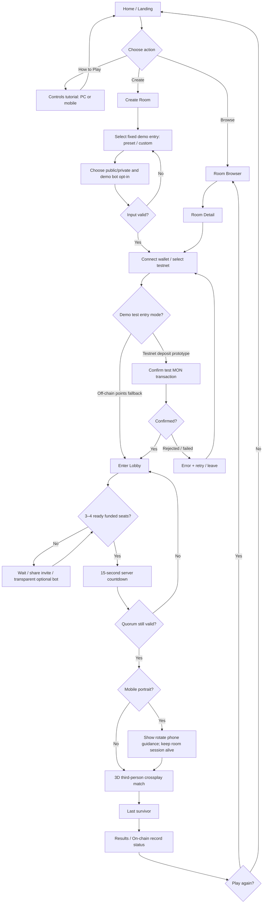
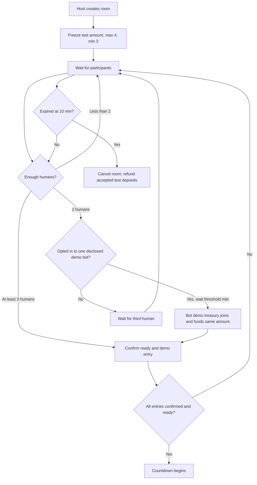
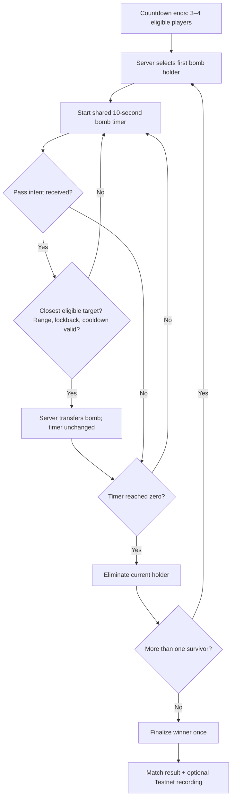
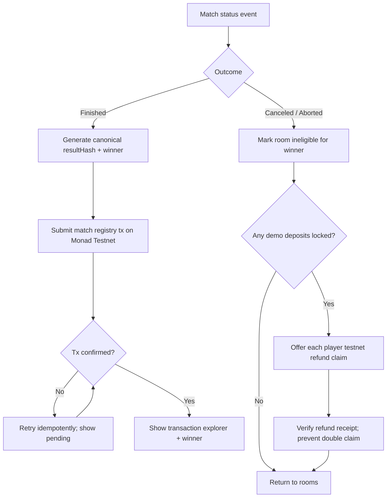
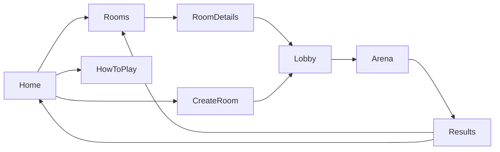
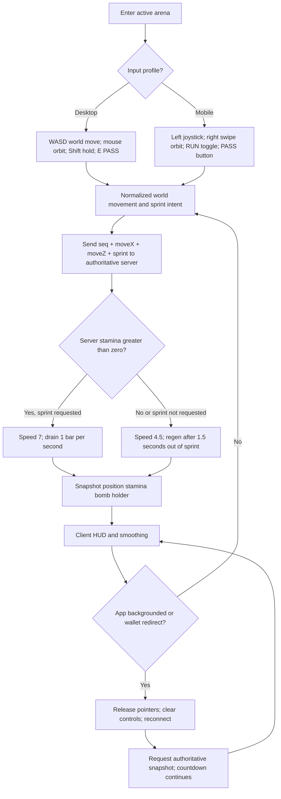
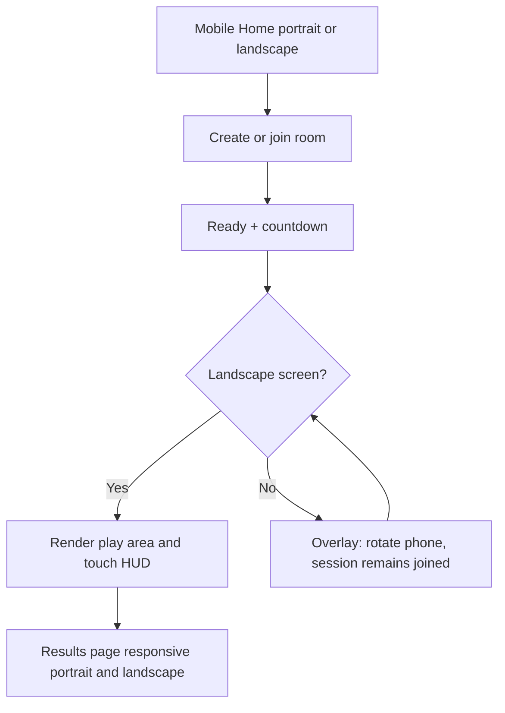

# FLOWCHART — Complete Player & Room Journeys

## A. Full UX flow: menu → room → play → result

## B. Room creation with bot and expiration

## C. Match lifecycle

## D. Demo settlement / cancellation

## E. UX route sitemap

## F. State invariants
- `JOINED` does not mean `CONFIRMED`/`READY`.
- Bot never counts toward humans, one bot maximum.
- Transaction pending is not deposit confirmed.
- Any quorum loss before `LIVE` cancels countdown rather than forcing a start.
- `FINISHED` has one human/bot winner; `ABORTED` has no winner.
- One room has one definitive result; settlement cannot be repeated.

## G. Desktop/mobile input, stamina, and reconnect

## H. Priority on mobile orientation

