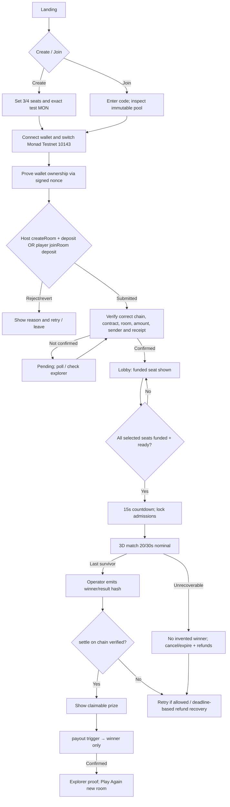
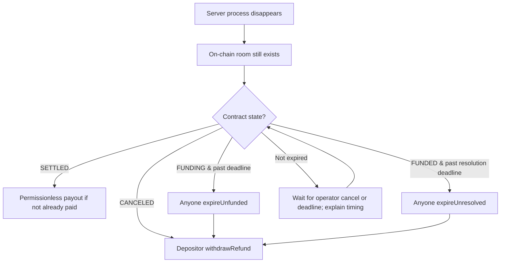

# FLOWCHART — v0.5 End-to-End Journeys & Recovery

## A. Player journey


## B. Escrow contract state machine

```mermaid
stateDiagram-v2
  [*] --> NONE
  NONE --> FUNDING: createRoom payable / host deposit
  FUNDING --> FUNDING: joinRoom payable / exact amount
  FUNDING --> FUNDED: count reaches seats
  FUNDING --> CANCELED: operator cancel OR expireUnfunded after deadline
  FUNDED --> SETTLED: onlySettler settle before resolution deadline
  FUNDED --> CANCELED: operator cancel OR expireUnresolved after deadline
  SETTLED --> SETTLED: payout exactly once; prizePaid=true
  CANCELED --> CANCELED: each depositor withdrawRefund once
```

`SETTLED` means claimable **not necessarily paid**; `CANCELED` means refundable **not necessarily withdrawn**. The escrow state is separate from game status.

## C. Server restart with funds escrowed


## D. Verification / trust boundaries
```mermaid
sequenceDiagram
  participant P as Browser + Wallet
  participant B as Game Server
  participant C as Monad Escrow
  P->>B: prepare / join-intent (wallet signed challenge)
  B-->>P: roomKey + exact entryWei + deadline
  P->>C: payable createRoom/joinRoom
  C-->>P: transaction hash (not proof yet)
  P->>B: txHash (untrusted reference)
  B->>C: fetch receipt + verify event/status
  C-->>B: verified member, amount, roomKey
  B-->>P: funded seat + accurate pool
  Note over P,B: Live movement off-chain, no blockchain per frame
  B->>C: onlySettler settle(winner,resultHash)
  C-->>B: MatchSettled confirmed
  B-->>P: winner claimable
  P->>C: payout(roomKey)
  C-->>P: PrizePaid receipt; winner address fixed
```
