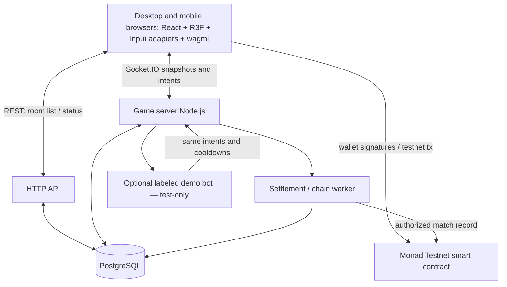
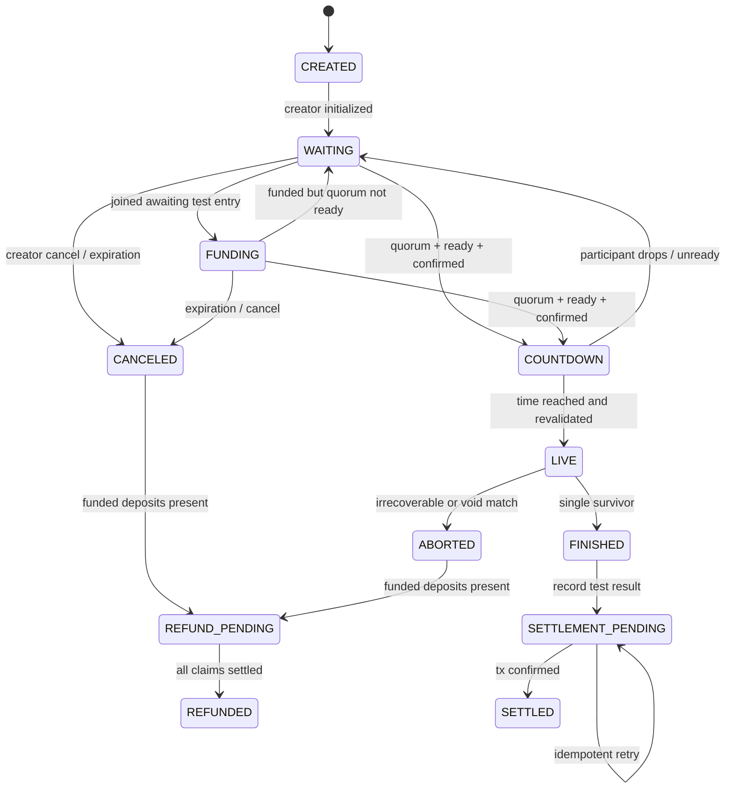
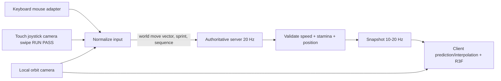

# SYS — System Architecture & Specification

## 1. Architectural stance
Use a **server-authoritative real-time game**, with 3D rendering on clients, database for session metadata, and an EVM contract on Monad **Testnet only** for verifiable demo records / optional test-asset escrow. Never put every frame on chain; chain is not a realtime transport.

## 2. Bounded contexts
- **Identity:** wallet address and ephemeral guest session; no custody of private keys.
- **Lobby service:** room code, immutable demo amount, invites, quorum, Ready, countdown.
- **Simulation server:** position, pass timing, bomb timer, elimination, game-result authority.
- **Testnet adapter:** optional escrow/deposit receipts, match record, status polling, refunds.
- **Bot agent:** test-only equal-rules adversary; operator-funded participation separately auditable.
- **Postgres store:** metadata, read models, audit events; chain is canonical for transaction state.

## 3. Room state machine

## 4. Data and trust boundaries
- Client is untrusted: display state and send intents only. It must not submit winner, collision, deposit confirmation or settlement status.
- Server is authority for simulation but is **not trustless**. Signed match results attest operator judgment, not independent correctness.
- Smart contract is authority for testnet deposit balances, accepted match settlement and refund state; database indexes chain data but does not override it.
- Admin/developer must not alter live rooms, grant bot privileges, or manually settle an unverified result. All admin actions have append-only audit entries.

## 5. Game timing and networking
- Tick: initial target 20 Hz server; snapshots 10–20 Hz; render 60 FPS with interpolation.
- Inputs include monotonically increasing sequence ID and room/session token.
- Determine elapsed bomb time **and stamina integration** from monotonic server clock, not client clocks. Server clamps dt and normalizes movement vectors; camera is client-owned.
- Serialize bomb-pass acceptance atomically within room event loop; ensure two simultaneous pass intents cannot both win.
- Resume by `(room_id, session_id, last_seen_sequence)` on reconnect; enforce one active socket per player/session where appropriate.

## 6. Demo bot fairness
1. Creator explicitly enables **one demo bot** and lobby UI labels it with icon + wallet/treasury source.
2. Bot may join only if ≥2 humans are ready and the lobby wait threshold elapsed; cannot be used to disguise attendance.
3. Bot perceives only information available to human clients (positions/holder/timer) and is governed by the same movement speed and cooldowns.
4. In P0 the bot contributes the same **virtual points** as a human, with no on-chain transfer. If optional P2 testnet escrow is built, its test deposit comes from a clearly disclosed test treasury, and the result page reveals the destination. This is **not** a blueprint for real-money house competition.
5. Publish decision constraints/seed; never present an unverified bot as independently fair.

## 7. Testnet settlement integration, two delivery levels
- **P0 fallback (strongly preferred for six-hour delivery):** no value-bearing escrow. Use non-transferable off-chain demo score; after match write `roomId / winner / resultHash` to chain. Confirm explorer receipt.
- **P1 optional:** hold test MON deposits per room in audited minimal contract; after authoritative server reports winner and contract verifies uniqueness, release entire **testnet** room pool once. For canceled matches, allow permissionless per-user testnet refunds. Mainnet deployment disabled by CI/environment gate.
- Do not describe a centralized signed result as provably fair without additional verification guarantees.

## 8. Cancellation / no-show policy
- Fewer than 3 active contestants at countdown end: abort start, return lobby; if expired, cancel and enable claim/refund.
- Bot not funded: do not count bot toward quorum.
- In LIVE, disconnect grace 3s, then eliminate; if all disconnect, mark ABORTED, no fabricated winner.
- Match result store uses unique `room_id`; settlement worker uses `(chain_id, contract, match_id)` deduplication key.

## 9. Deployment topology
- Static frontend: Vercel/Cloudflare Pages.
- Socket/API: single process Node.js with websocket-capable host for MVP; no distributed server without shared room coordination.
- Postgres: managed if time allows; in-memory room state with Postgres audit read-model in MVP.
- Blockchain: Monad Testnet `10143`; gas-paid wallet transactions; verified explorer links.

## 10. Cross-platform input pipeline (v0.3)

- Camera yaw/pitch/distance belong to the client only; cannot directly change server collision or bomb state.
- Inputs are a **world-space vector**, derived client-side from local WASD/joystick direction and camera yaw. Server clamps magnitude to 1 and uses configured speeds independently of input device.
- Each player server state includes `position`, `velocity`, `stamina` (0..5), `isSprinting`, `lastSprintEndedAt`, `alive`, `lastPassAt`, and lockback sender/expiry.
- Sprint consumes 1.0 bar/second only while active. Once sprint ends, no regen for 1.5 s; then regen 1.0 bar/second while not sprinting. At zero, forced walk and RUN toggle visually resets.
- Do not process stamina by counting client keypresses or frames; enforce from monotonic authoritative simulation time.
- Bomb targeting uses nearest eligible player within 1.8 units, excluding eliminated targets and blocked former holder within 1 s. Concurrent passes are serialized deterministically.
- 3D client visual interpolation/smoothing must **not** modify authoritative hit detection; no unfair client-side PASS success animation before server acceptance.

## 11. Mobile browser / lifecycle boundary
- Menus support portrait and landscape; match UI designed landscape, showing a rotate overlay in portrait rather than assuming orientation lock works.
- Use Pointer Events with independent `pointerId` handling for joystick, orbit and buttons; release on `pointercancel`, loss of focus and visibility changes. Apply `touch-action: none` only on gameplay touch zones.
- `visibilitychange` and wallet-app deep links: clear input, reconnect/rejoin by session token and request latest authoritative snapshot. Match server timer continues; app backgrounding gives no paused-timer advantage.
- Limit device pixel ratio and effects based on real device performance; require HTTPS, secure websocket and responsive canvas resize/orientation updates.
