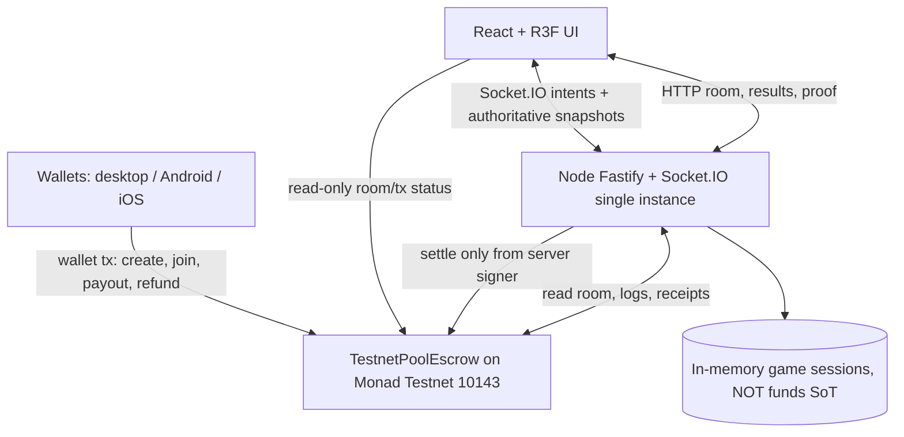

# SYS — System Architecture v0.5

## Architecture and authority boundaries

The chain is not a real-time transport. Movements, stamina, passes and 10-second bomb cycle remain off-chain. Only room funding, winner result commitment, payout and refunds are on-chain. Server is a trusted winner oracle.

## Two orthogonal state machines
**Game:** `WAITING → COUNTDOWN → LIVE → FINISHED`; `WAITING/COUNTDOWN/LIVE → CANCELED` with reason, never winner fabricated.  
**Escrow:** `NONE → FUNDING → FUNDED → SETTLED → paid bool`; `FUNDING/FUNDED → CANCELED → individual withdrawals`.

| UI/Server game | Escrow | Allowed meaning |
|---|---|---|
| WAITING | FUNDING | Accept funding, ready blocked |
| WAITING | FUNDED | All deposits present; wait all ready |
| COUNTDOWN | FUNDED | Admission closed; countdown anchored on server |
| LIVE | FUNDED | Gameplay, no token operations per frame |
| FINISHED | FUNDED | Result determined; settlement pending |
| FINISHED | SETTLED | Winner claimable or already paid; never imply transfer without PrizePaid receipt |
| CANCELED | CANCELED | Refundable; each depositor withdraws themselves |
| CANCELED/FINISHED | FUNDED | May still need operator cancel/expiry; show recovery path, not 'refunded' |

**Guard:** Never enter COUNTDOWN if `depositCount < maxPlayers`, any seated wallet differs from depositor set, any wallet duplicates, pending txs, or any READY missing. The server re-reads contract state at start and binds account-to-session; it cannot invent deposit confirmations.

## Lifecycle decisions
1. Prepare generates immutable server room identifier, contract room key and 6-char code; only after host confirms `RoomCreated` is active room materialized.
2. Players sign one-time wallet login challenge linked to app origin, chain 10143, nonce and expiry. Server maintains session and checks address match.
3. Joiners pay native test MON with `joinRoom`, server indexes chain logs and independently verifies receipt. The frontend can poll contract for quicker UX; server confirmation is required for seated ready.
4. Contract reaching FUNDED does **not** automatically mean a game started. Require all ready; countdown locks admission.
5. Match 20/30s nominal. Any unrecoverable disconnect / full server restart means no winner. Operator can cancel while still eligible; after resolution deadline anyone can expire/refund.
6. On `FINISHED`, server computes versioned `resultHash` and submits `settle` from dedicated testnet signer; only a valid depositor wallet can win. A successful receipt makes pool CLAIMABLE, not PAID.
7. the server relayer automatically sends `payout(roomKey)` after verified settle, with permissionless manual fallback; it sends claim to winner; refund functions only if room CANCELED. Both are transaction receipts with independent confirmation UI.

## Reconciliation & restart strategy
- Source of truth for pot, membership, outcome allocation and withdrawals is **contract storage/events**. Room in-memory `Map` is an ephemeral cache of session/physics, not custody ledger.
- On startup, load deployed contract address and deployment block from configuration. Scan events in bounded chunks with dedupe `(chainId, txHash, logIndex)`, rebuild `roomKey → chain escrow state`. REST `GET /api/escrow/:roomKey` always able to read chain without memory.
- `code → roomKey` mapping is ephemeral in P0; if lost, player recovery uses saved `roomKey` / transaction event. **Never pretend code recovery survives server restart without persistent mapping.** Include roomKey in invite and client local recoverable link query; a player may also copy tx hash.
- On restart, a LIVE room is not resumed (P0 limitation): no fabricated winner; users may await operator abort or wait for on-chain deadline and use `expireUnresolved + withdrawRefund` without backend.
- Handle duplicated events idempotently, transient RPC failures with bounded exponential backoff, and reconcile prior to retrying `settle` or `payout`.

## Clock and integrity
- Server monotonic time drives live bomb cycle and stamina; timestamps emitted to clients plus offsets. `block.timestamp` (seconds) drives funding/resolution expiry only. They are independent clocks.
- Game input never contains player position, holder, winner, chain status, or contract pot.
- Network clients operate via sessions that bind wallet proof; do not authorize funded seat from arbitrary reported address or tx hash.
- Keep event source block number and receipt status for settlement audit. This is an **operator-determined match result** documented on chain, not tamper-proof game evidence.

## Operational controls
- HTTPS single origin and WSS; CSP, safe environment variables, secure signer secrets, contract allowlist, rate limiting, zod validation, strict CORS, no secrets in Vite public env.
- One server process; if application unavailable, contract controls still permit expired cancellation, refund and payout via wallet transaction independent of app.
- `GET /health` tests server responsiveness; separate chain health test should distinguish RPC lag from simulation failure.
